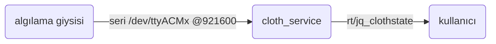

<div align="center">

# Unitree G1 Dokunsal Algılama Giysisi Türkçe: G1_cloth_service Seri-DDS Servisi ve Python Çözücü

**CH343 seri bağlantı · 256 dokunsal sensör + jiroskop dördeyi · `rt/jq_clothstate` DDS konusu · 100 Hz yayın**

**Unitree Robotics Türkiye Resmi Distribütörü · [Robotlar.org](https://www.robotlar.org)**

👉 **[Unitree G1](https://www.robotlar.org/tr/insansi-robotlar/unitree-g1) · [G1 EDU projeniz için teklif](https://www.robotlar.org/tr/fiyat/unitree-g1-edu-fiyat) · [Türkçe dokunsal giysi rehberi](https://www.robotlar.org/tr/rehber/unitree-g1-dokunsal-giysi-rehberi)**

[Kurulum](#-1-kurulum) · [Başlatma](#-2-başlatma) · [Otomatik Başlatma](#-3-otomatik-başlatma-servisi) · [Veri Nasıl Akar](#-veri-nasıl-akar) · [Python Çözücü](#-python-çözücü) · [Ayrıntılı Rehber](docs/AYRINTILI-REHBER.md)

</div>

> Bu depo, Unitree Robotics'in resmi [unitreerobotics/G1_cloth_service](https://github.com/unitreerobotics/G1_cloth_service) projesinin (BSD-3-Clause, 18.11.2026 tarihli `271b054` commit'i) Türkçe çevirisidir. C++ kaynak kodu ve `3rd/` altındaki SDK ile kurulum paketleri orijinal depoda kalır. Burada Türkçe anlatım, saf Python çözücü (`python/`) ve testleri bulunur. Servisi derlemek için orijinal depoyu klonlayın.
>
> Çeviri, Python çözücü ve Türkçe teknik destek: Unitree Türkiye resmi distribütörü [Robotlar.org](https://www.robotlar.org).

## 📖 0. Giriş

Bu proje, G1 dokunsal algılama giysisi (tactile sensing cloth) için bir seri-DDS (serial2dds) servisidir.

Algılama giysisi bilgisayara CH343 USB-seri dönüştürücüyle bağlanır (VID:PID `1a86:55d3`, aygıt düğümü `/dev/ttyACM*`) ve 921600 baud hızında haberleşir. Servis seri çerçeveleri okuyup birleştirir (256 sensör değeri + jiroskop dördeyi) ve sonucu DDS üzerinden 100 Hz ile yayınlar.



DDS mesaj düzeni (konu (topic) `rt/jq_clothstate`, tip `sensor_msgs::msg::dds_::PointCloud2_`, yalnız `data` bayt dizisi kullanılır):

| Baytlar | İçerik |
|---|---|
| `data[0..15]` | jiroskop dördeyi (quaternion), 4 adet float32 (w, x, y, z), little-endian |
| `data[16..271]` | 256 sensör değeri, her biri 8 bit |

## 📦 1. Kurulum

```bash
sudo apt update
sudo apt install libserialport-dev
cd ~
git clone https://github.com/unitreerobotics/G1_cloth_service
cd G1_cloth_service
bash build.sh
```

Derleme betiği sistemin varsayılan derleyicisini (C++17, CMake >= 3.10) kullanır ve ana makinenin mimarisine (`uname -m`) uygun SDK kitaplıklarını kendisi seçer. unitree_sdk2 (DDS) bağımlılığı depoda `3rd/unitree_sdk2` altında gelir (`x86_64` ve `aarch64` için önceden derlenmiş). Çalıştırılabilir dosyalar `bin/` altında oluşur:

- `bin/cloth_service`: servisin kendisi
- `bin/JqDdsTest`: DDS abone test aracı

> 💡 Not: `3rd/serialport` klasörü, `sudo apt install libserialport-dev` komutunun çevrimdışı paketlerini (Ubuntu 22.04) `arm64` (Jetson) ve `amd64` (x86_64) makineler için içerir. `libserialport` kurulumunda sorun yaşarsanız bu deb paketlerini kurun. Önce `libserialport0`, sonra `libserialport-dev` kurulur:
> ```bash
> # arm64 (NVIDIA Jetson Orin NX)
> sudo dpkg -i 3rd/serialport/libserialport0_0.1.1-3_arm64.deb
> sudo dpkg -i 3rd/serialport/libserialport-dev_0.1.1-3_arm64.deb
>
> # amd64 / x86_64 PC
> sudo dpkg -i 3rd/serialport/libserialport0_0.1.1-3_amd64.deb
> sudo dpkg -i 3rd/serialport/libserialport-dev_0.1.1-3_amd64.deb
> ```

## 🚀 2. Başlatma

```bash
# servisi başlatın (seri port erişimi root ya da dialout grubu ister)
sudo ./bin/cloth_service
```

Servis açılışta USB aygıtının tanınması için en çok 30 saniye bekler, ardından portu açar ve yayına başlar.

Veriyi doğrulamak için test abonesini çalıştırın:

```bash
# geri döngü (loopback, varsayılan) ya da belirli bir ağ arayüzü üzerinden abone olun
./bin/JqDdsTest
./bin/JqDdsTest eth0
```

Araç alım hızını, jiroskop dördeyini ve 256 sensör değerini yazdırır.

## 🚀🚀🚀 3. Otomatik Başlatma Servisi

`cloth_service` derlenip testten geçtikten sonra sistem açılışında kendiliğinden başlaması için yapılandırın:

```bash
bash setup_autostart.sh
```

Betik, açılışta `bin/cloth_service` dosyasını başlatan `G1_cloth.service` (systemd) birimini kurar. Birim `Restart=always` ile, `unitree` kullanıcısı ve `dialout` grubuyla çalışır; `LD_LIBRARY_PATH` depodaki SDK kitaplıklarını gösterir. Servisi şu komutlarla yönetin:

```bash
sudo systemctl status G1_cloth.service      # durumu göster
sudo journalctl -u G1_cloth.service -f      # günlüğü canlı izle
sudo systemctl restart G1_cloth.service     # servisi yeniden başlat
sudo systemctl stop G1_cloth.service        # servisi durdur
sudo systemctl disable G1_cloth.service     # açılışta başlatmayı kapat
```

`journalctl` dışında geçmiş günlük dosyaları `/unitree/var/log/cloth_service` altında durur (10 MB × 3 eşzamansız döndürme, `config/default_logconf.json` dosyasında ayarlı):

```bash
ls /unitree/var/log/cloth_service
```

## 🔬 Veri Nasıl Akar

Aşağıdaki ayrıntılar orijinal deponun kaynak kodundan (`include/JqProtocol.h`, `src/JqProtocol.cpp`, `src/cloth_service.cpp`, `src/JqDds.cpp`, `src/main.cpp`, `setup_autostart.sh`) doğrulandı.

**Seri çerçeve.** Her çerçeve dört baytlık `AA 55 03 99` başlığıyla başlar. Başlığı bir sıra baytı, bir sensör tipi baytı ve veri izler:

| Sıra baytı | Çerçeve | Veri | İçerik |
|---|---|---|---|
| `0x01` | 134 bayt | 128 bayt | ilk 128 sensör değeri |
| `0x02` | 150 bayt | 144 bayt | son 128 sensör değeri + 16 bayt jiroskop verisi |

| Sensör tipi baytı | Kısaltma | Bölge |
|---|---|---|
| `0x01` | LH | sol el |
| `0x02` | RH | sağ el |
| `0x03` | LF | sol ayak |
| `0x04` | RF | sağ ayak |
| `0x05` | WB | tüm gövde |

**Birleştirme.** Alıcı önce `0x01` paketini saklar, ardından gelen `0x02` paketiyle birleştirir. İki paketin sensör tipi aynı ve veri uzunlukları 128 ile 144 olmalıdır. Sonuçta 256 sensör değeri (her biri 0-255) ve 16 jiroskop baytından kurulan bir dördey çıkar. Her dört bayt bir bileşendir (little-endian IEEE754 float), sıra w, x, y, z.

**Akış koruması.** Ayıklayıcı başlıktan önceki çöp baytları atar. Sıra baytı geçersizse bir bayt kaydırıp yeniden eşler. Yarım kalan çerçeve, kalan baytlar gelene kadar tamponda bekler. Başlık bulunamazsa bölünmüş başlık ihtimaline karşı son 3 bayt tutulur. Tampon 4096 baytı aşarsa da son 3 bayt dışı temizlenir.

**DDS yayını.** Birleşik ölçüm 272 baytlık `data` dizisine yazılır: `data[0..15]` dördey (w, x, y, z, little-endian float32), `data[16..271]` 256 adet 8 bit değer. Yayın iş parçacığı her 0,01 saniyede (100 Hz) son ölçümü `rt/jq_clothstate` konusuna gönderir. Sensör tipi baytı yüke yazılmaz.

**Seri port ve açılış.** Servis `/sys/class/tty` altında VID `1a86`, PID `55d3` olan aygıtı arar ve 921600 baud ile açar. Aygıtı 500 ms arayla 60 kez, yani en çok 30 saniye bekler. Bulamazsa `Serial device 1a86:55d3 not found` yazıp çıkar. DDS alan kimliği 0'dır.

**Servis birimi ve günlük.** `G1_cloth.service` birimi `User=unitree`, `Group=dialout`, `Restart=always` ve `RestartSec=5` ile çalışır. Günlük `/unitree/var/log/cloth_service` klasörüne 10 MB'lık 3 dosya halinde döner.

## 🐍 Python Çözücü

Bu depoya, C++ protokol mantığının yalnız standart kütüphaneyle (`struct`) yazılmış Python karşılığını ekledik:

| Dosya | İçerik |
|---|---|
| [python/g1_giysi.py](python/g1_giysi.py) | `cerceveleri_ayikla` (C++ `extractFrames` karşılığı, 4096 bayt koruması dahil), `birlestir`, `dds_verisini_coz`, `sensor_tipi_adi`, `SeriAkisBirlestirici` |
| [python/ornek_dds_abone.py](python/ornek_dds_abone.py) | unitree_sdk2_python ile `rt/jq_clothstate` konusuna abone olup çözücüyü çağıran örnek |
| [tests/test_g1_giysi.py](tests/test_g1_giysi.py) | sentetik çerçevelerle birim testleri |

```python
from unitree_sdk2py.core.channel import ChannelSubscriber, ChannelFactoryInitialize
from unitree_sdk2py.idl.sensor_msgs.msg.dds_ import PointCloud2_
from g1_giysi import dds_verisini_coz

def geldi(msg):
    veri = dds_verisini_coz(msg.data)
    print(veri["dordey"], veri["sensorler"][:16])

ChannelFactoryInitialize(0, "eth0")
abone = ChannelSubscriber("rt/jq_clothstate", PointCloud2_)
abone.Init(geldi, 1)
```

Testleri depo kökünden çalıştırın:

```bash
python3 -I -m unittest discover -s tests
```

## 🤖 G1 ile Kullanım

Servis, [G1 EDU](https://www.robotlar.org/tr/fiyat/unitree-g1-edu-fiyat) geliştirme bilgisayarında ya da bir x86_64 PC'de derlenir. Kaynak README, arm64 paketlerini NVIDIA Jetson Orin NX için verir. Derleme betiği iki mimariyi de tanır.

Dokunsal giysi, G1 ailesi projelerinde ([Unitree G1](https://www.robotlar.org/tr/insansi-robotlar/unitree-g1), [G1 Plus](https://www.robotlar.org/tr/insansi-robotlar/unitree-g1-plus), [G1 EDU](https://www.robotlar.org/tr/fiyat/unitree-g1-edu-fiyat)) 256 noktalı dokunsal veriyi ve jiroskop dördeyini tek DDS konusunda toplar. Dokunsal sensörlü [Dex3-1](https://www.robotlar.org/tr/robot-elleri/unitree-dex3-1) ya da [Dex5-1](https://www.robotlar.org/tr/robot-elleri/unitree-dex5-1) el seçenekleriyle birlikte el ve gövde dokunuşunu aynı DDS ağında okursunuz. Bu veriyi taklit öğrenme ve teleoperasyon kayıtlarına ek gözlem kanalı olarak ekleyebilirsiniz.

- Veri toplama ve taklit öğrenme: [Unitree LeRobot rehberi](https://www.robotlar.org/tr/rehber/unitree-lerobot-rehberi)
- Uzaktan kumanda ile gösterim kaydı: [G1 teleoperasyon rehberi](https://www.robotlar.org/unitree/g1-teleoperasyon)
- Geliştirme bilgisayarı: [Jetson Orin rehberi](https://www.robotlar.org/tr/rehber/saha-robotu-jetson-orin-dayanikli-bilgisayar)
- DDS ve SDK temelleri: [Unitree SDK rehberi](https://www.robotlar.org/unitree/sdk-rehberi)
- Araştırma kurulumları: [G1 Ar-Ge platformu](https://www.robotlar.org/tr/g1-arge-platformu)

## ❓ SSS

1. Servis `Serial device 1a86:55d3 not found` hatasıyla çıkıyor:
   - Algılama giysisi bağlı değil ya da kablo gevşek. `lsusb` ile (`1a86:55d3` satırını arayın) ve `ls /dev/ttyACM*` ile kontrol edin.
2. CMake `local unitree_sdk2 not found` hatası veriyor:
   - `3rd/unitree_sdk2` klasörü eksik ya da yarım. Depoyla gelen SDK'yı geri yükleyin.
3. `JqDdsTest` başka bir makinede veri almıyor:
   - İki makinenin aynı alt ağda olduğundan emin olun ve doğru ağ arayüzü adını (ör. `eth0`) ilk argüman olarak verin.

Ayrıntılı sorun giderme için [docs/AYRINTILI-REHBER.md](docs/AYRINTILI-REHBER.md#-sorun-giderme) dosyasına bakın.

## 📚 Belgeler

| Dosya | İçerik |
|---|---|
| [docs/AYRINTILI-REHBER.md](docs/AYRINTILI-REHBER.md) | Kurulum sırası, derleme çıktıları, başlatma, test aboneliği, otomatik başlatma, SSS ve genişletilmiş sorun giderme |

---

## 🤖 Unitree Ürün Ailesi (Türkiye)

Robotlar.org, Unitree Robotics'in Türkiye resmi distribütörüdür. Aşağıdaki ürünlerin Türkçe tanıtımı, teknik özellikleri ve kurumsal teklif formu sitede yer alır. Fiyatlar konfigürasyona göre değiştiği için [teklif üzerinden](https://www.robotlar.org/tr/fiyat/unitree-kurumsal-teklif-al) paylaşılır.

### İnsansı robotlar

| Ürün | Ne işe yarar |
|---|---|
| [Unitree G1](https://www.robotlar.org/tr/insansi-robotlar/unitree-g1) | 132 cm, 35 kg, 23-43 DoF insansı robot |
| [Unitree G1 EDU teklif](https://www.robotlar.org/tr/fiyat/unitree-g1-edu-fiyat) | Geliştirme bilgisayarlı, SDK erişimli araştırma sürümü |
| [Unitree G1-D](https://www.robotlar.org/tr/insansi-robotlar/unitree-g1-d) | İnsansı robot veri toplama ve eğitim platformu, Jetson Orin |
| [Unitree G1 Plus](https://www.robotlar.org/tr/insansi-robotlar/unitree-g1-plus) | 2 DoF boyun, yüksek tork, dokunsal kafa ve 6 mikrofonlu G1 |
| [Unitree H2](https://www.robotlar.org/tr/insansi-robotlar/unitree-h2) | 182 cm, 70 kg, 31 DoF tam boy insansı robot |
| [Unitree H2 Plus](https://www.robotlar.org/tr/insansi-robotlar/unitree-h2-plus) | NVIDIA Isaac GR00T referans insansı robotu, 75 DoF, Jetson Thor |
| [Unitree R1](https://www.robotlar.org/tr/insansi-robotlar/unitree-r1) | 123 cm, 29 kg, 26 DoF insansı robot (AIR, R1, EDU sürümleri) |
| [Tüm insansı robotlar →](https://www.robotlar.org/tr/insansi-robotlar) | |

### Robot elleri

| Ürün | Ne işe yarar |
|---|---|
| [Unitree Dex3-1](https://www.robotlar.org/tr/robot-elleri/unitree-dex3-1) | G1 için 7 serbestlik dereceli el, opsiyonel 33 dokunsal sensör |
| [Unitree Dex5-1](https://www.robotlar.org/tr/robot-elleri/unitree-dex5-1) | 20 serbestlik dereceli (16 aktif) el, Dex5-1P sürümünde 94 dokunsal sensör |
| [Unitree Dex1-1](https://www.robotlar.org/tr/robot-elleri/unitree-dex1-1) | İki çeneli tutucu: 90 mm strok, 5-120 N ayarlı kavrama, RS-485 |
| [Tüm robot elleri →](https://www.robotlar.org/tr/robot-elleri) | |

**Dört ayaklı robotlar:** [Go2](https://www.robotlar.org/tr/kopek-robotlar/unitree-go2) · [B2](https://www.robotlar.org/tr/kopek-robotlar/unitree-b2) · [A2](https://www.robotlar.org/tr/kopek-robotlar/unitree-a2) · [AS2](https://www.robotlar.org/tr/kopek-robotlar/unitree-as2) · [Tüm dört ayaklı robotlar](https://www.robotlar.org/tr/kopek-robotlar)

**Bileşenler:** [4D LiDAR L2](https://www.robotlar.org/tr/unitree-bilesenler/4d-lidar-l2) · [Tüm Unitree bileşenleri](https://www.robotlar.org/tr/unitree-bilesenler) · [Yedek parça](https://www.robotlar.org/tr/unitree-yedek-parca)

## 📖 Türkçe Rehberler

- [Unitree G1 dokunsal algılama giysisi rehberi](https://www.robotlar.org/tr/rehber/unitree-g1-dokunsal-giysi-rehberi)
- [Unitree G1 MotionBricks rehberi](https://www.robotlar.org/tr/rehber/unitree-g1-motionbricks-rehberi)
- [Unitree G1 Isaac GR00T rehberi](https://www.robotlar.org/tr/rehber/unitree-g1-isaac-gr00t-rehberi)
- [Unitree LeRobot: veri toplama ve taklit öğrenme](https://www.robotlar.org/tr/rehber/unitree-lerobot-rehberi)
- [Unitree G1 XR teleoperasyon](https://www.robotlar.org/unitree/g1-teleoperasyon)
- [Unitree SDK rehberi](https://www.robotlar.org/unitree/sdk-rehberi)
- [Unitree RL Gym](https://www.robotlar.org/unitree/rl-gym)
- [Saha robotu için Jetson Orin bilgisayar](https://www.robotlar.org/tr/rehber/saha-robotu-jetson-orin-dayanikli-bilgisayar)
- [Unitree eğitim çözümleri (üniversite ve laboratuvar)](https://www.robotlar.org/tr/unitree-egitim-cozumleri)
- [Tüm açık kaynak Unitree projeleri (Türkçe)](https://www.robotlar.org/tr/acik-kaynak)

## 🔗 Unitree Türkiye GitHub Ağı

**Modeller:** [G1](https://github.com/Unitree-Turkiye/unitree-g1-turkce) · [Go2](https://github.com/Unitree-Turkiye/unitree-go2-turkce) · [B2](https://github.com/Unitree-Turkiye/unitree-b2-turkce) · [A2](https://github.com/Unitree-Turkiye/unitree-a2-turkce) · [H2](https://github.com/Unitree-Turkiye/unitree-h2)
**Geliştirici:** [SDK2](https://github.com/Unitree-Turkiye/unitree-sdk2-turkce) · [XR Teleoperasyon](https://github.com/Unitree-Turkiye/unitree-teleoperasyon-turkce) · [G1 MotionBricks](https://github.com/Unitree-Turkiye/unitree-g1-motionbricks-turkce) · [G1 Dokunsal Giysi](https://github.com/Unitree-Turkiye/unitree-g1-dokunsal-giysi-turkce) · [LeRobot](https://github.com/Unitree-Turkiye/unitree-lerobot-turkce) · [🏠 Unitree Türkiye](https://github.com/Unitree-Turkiye)

## 📄 Lisans

Orijinal proje BSD 3-Clause lisansıyla yayınlanır:

```
Copyright (c) 2026, Unitree Robotics
```

Bu depo aynı lisansı izler ([LICENSE](LICENSE)). Türkçe belgeler orijinal README'nin çevirisidir; değişiklik olarak Türkçeleştirme, "Veri Nasıl Akar", "G1 ile Kullanım" bölümleri ve `python/` altındaki çözücü eklendi. Python çözücü ve çeviri: Copyright (c) 2026 EP Robot Teknoloji (Robotlar.org). C++ kaynak kodu, `3rd/` altındaki SDK ve paketler bu depoya kopyalanmadı; orijinal depoda kalır. Unitree Robotics talep ederse çeviri kaldırılır.

---

> ℹ️ **Unitree Türkiye:** Unitree Robotics'in Türkiye resmi satış ve teknik distribütörü. G1 ve robot elleri tedariki, kurulum, eğitim ve Türkçe geliştirici desteği: **[robotlar.org](https://www.robotlar.org/tr/rehber/unitree-turkiye-distributoru)** · 📧 info@robotlar.org

© 2026 **[www.robotlar.org](https://www.robotlar.org)**
